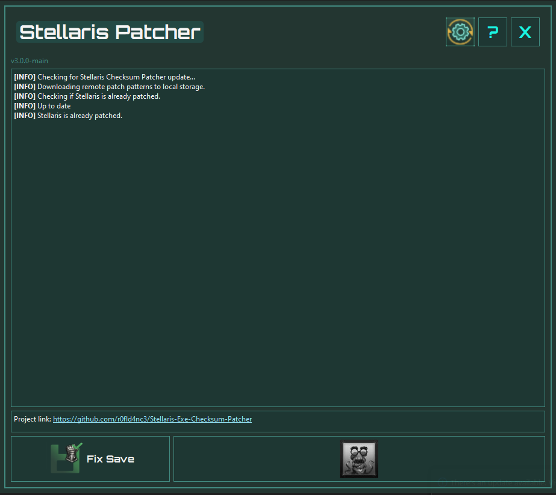
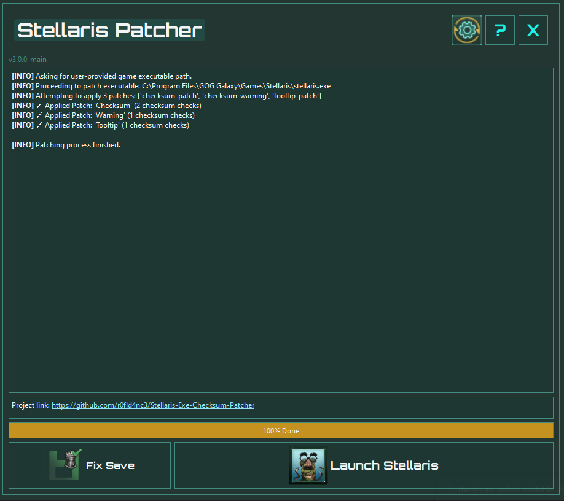
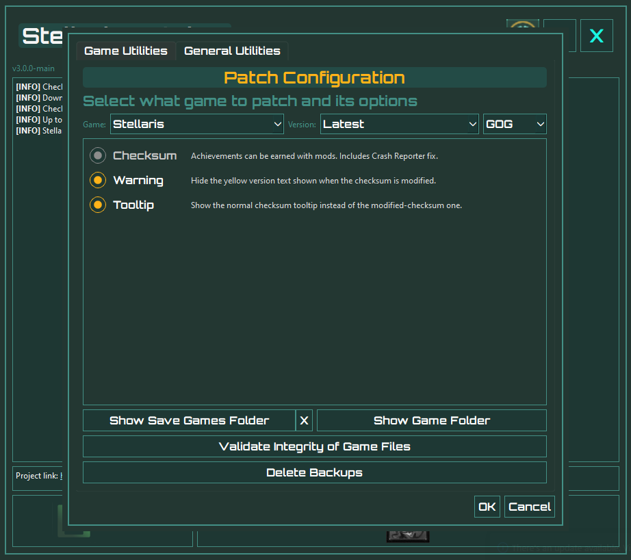
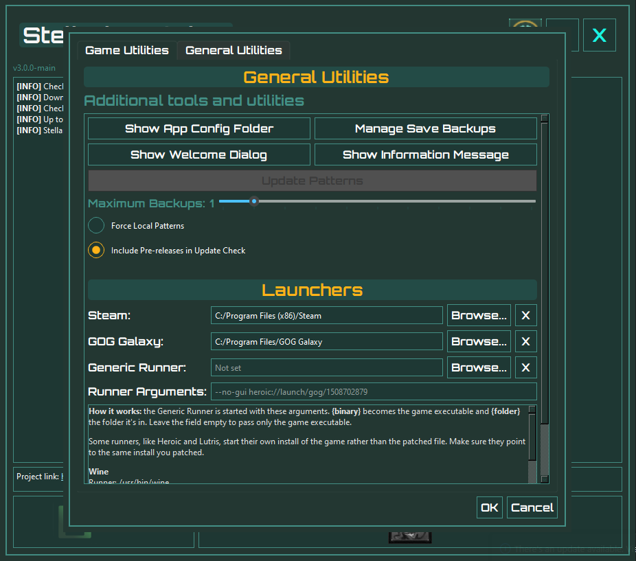
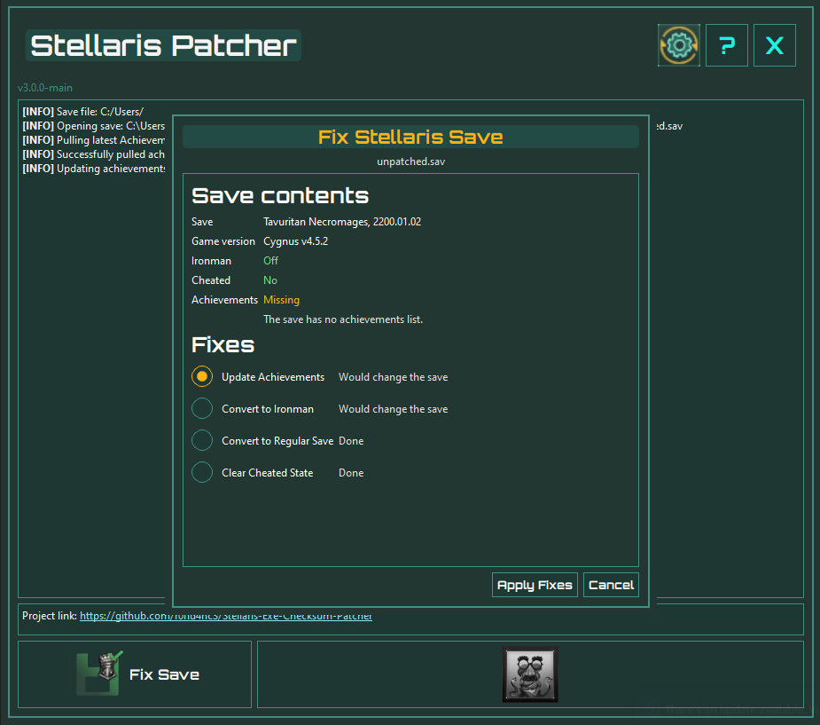
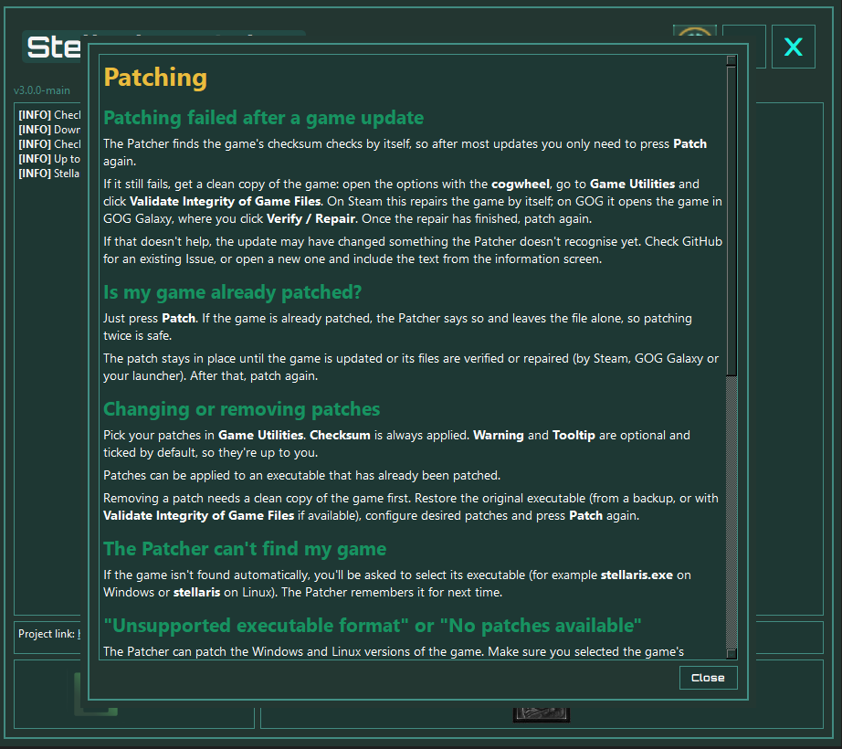

# Stellaris Checksum Patcher

### Earn Stellaris achievements while playing with mods

<!-- Release info -->
[](https://github.com/r0fld4nc3/Stellaris-Exe-Checksum-Patcher/releases/latest)
[](https://github.com/r0fld4nc3/Stellaris-Exe-Checksum-Patcher/releases)
[](https://github.com/r0fld4nc3/Stellaris-Exe-Checksum-Patcher/releases/latest)
[](https://store.steampowered.com/app/281990/Stellaris/)

[](https://github.com/r0fld4nc3/Stellaris-Exe-Checksum-Patcher/releases/latest)
[](#)

<!-- Supports -->
[](https://www.python.org/)
[](https://nuitka.net/)
[](https://github.com/r0fld4nc3/Stellaris-Exe-Checksum-Patcher/commits)
[](https://github.com/r0fld4nc3/Stellaris-Exe-Checksum-Patcher/stargazers)
[](LICENSE)

---

## Purpose

Stellaris turns off achievements when you play with mods that change the game's files. This can be true even for harmless mods, such as visual or quality-of-life ones.

This app makes a small, automatic change to the game's executable so that achievements stay enabled while you use those mods. No technical knowledge is needed. You click a button and the app does the rest.

<p align="center">


</p>

<p align="center">


</p>

<p align="center">


</p>

> [!IMPORTANT]
> Please read the [Disclaimer](#disclaimer) and [My Stance](#my-stance) before using this tool. In short: use it for quality-of-life and visual mods, not to cheat.

---

## How to use it

### 1. Download

Pick the version for your system:

| System  | Download |
|---------|----------|
| Windows | [Stellaris-Checksum-Patcher-win.exe](https://github.com/r0fld4nc3/Stellaris-Exe-Checksum-Patcher/releases/latest/download/Stellaris-Checksum-Patcher-win.exe) |
| Linux   | [Stellaris-Checksum-Patcher-linux](https://github.com/r0fld4nc3/Stellaris-Exe-Checksum-Patcher/releases/latest/download/Stellaris-Checksum-Patcher-linux) |
| macOS   | [Stellaris-Checksum-Patcher-macos.zip](https://github.com/r0fld4nc3/Stellaris-Exe-Checksum-Patcher/releases/latest/download/Stellaris-Checksum-Patcher-macos.zip) |

All versions are also listed on the [Releases page](https://github.com/r0fld4nc3/Stellaris-Exe-Checksum-Patcher/releases).

> [!NOTE]
> Windows or your antivirus may show a warning when you download or open the app. This is expected and explained in [Troubleshooting](#troubleshooting--faq).

### 2. Patch the game

1. Close Stellaris if it is running.
2. Open the Stellaris Checksum Patcher.
3. Click **Patch**.
4. The first time, the app asks where your game comes from: **Steam**, **GOG** or **Generic**. See [Game stores](#game-stores).
5. If the app can't find your Stellaris installation, it asks you to select the game's executable. It remembers this for next time. To choose a different executable later, hold **Shift** while clicking **Patch**.
6. Wait for the app to confirm that patching is done.

That's it. Launch Stellaris as usual and play with your mods. You can also - optionally - use the app's **Launch** button.

Previously, this was mostly targeted at specifically Ironman saves, however, Paradox has since made it possible to earn achievements without Ironman.

Before changing anything, the app saves a backup of your original game executable.

---

## Features

### 🔧 Patch

- Finds the game's checksum checks by itself, directly in the game executable, so game updates shouldn't need a new version of the app.
- Looks for Stellaris through your game's store (Steam or GOG Galaxy). If it can't find it, it asks you to select the game's executable.
- Creates a versioned backup of your current game executable.
- Applies the patches you picked (see [Choose your patches](#choose-your-patches)).
- Remembers the game's location for next time.

### Choose your patches

Open the options (cogwheel at the top right) and go to **Game Utilities** to pick the patches:

| Patch | What it does |
|---|---|
| **Checksum** | Lets you earn achievements with mods. Always applied. |
| **Warning** | Hides the yellow version text the game shows when it's modified. |
| **Tooltip** | Shows the normal checksum tooltip instead of the modified-checksum one. |

All three are on by default. Untick **Warning** or **Tooltip** if you'd like to keep that reminder that the game is modified.

You can add a patch to an already patched game by ticking it and clicking **Patch** again. To remove one, restore the original game file first (see [How do I restore the original game file?](#how-do-i-restore-the-original-game-file)), then patch again.

### Game stores

The Patcher uses this to know where your copy of Stellaris comes from and enable automatic searches for paths.

You choose this the first time you patch, and can change it later in the options (cogwheel at the top right), under **Game Utilities**.

| Store | What happens |
|---|---|
| **Steam** | Finds the game in your Steam libraries. Launches and validates it through Steam. |
| **GOG** | Finds the game through GOG Galaxy. Launches it there, and opens it in Galaxy so you can **Verify / Repair** its files. Windows and macOS only, Linux support confirmed coming. |
| **Generic** | For anything else, or games started with another app. You select the runner to launch the game's executable yourself (_Heroic, Lutris, Bottles..._). |

The store doesn't change how the game is patched. It only tells the Patcher where to look for the game and how to launch and validate it.

The Steam and GOG Galaxy folders are found automatically. If they're somewhere unusual, set them in the options under **General Utilities** > **Launchers**.

### Launching

After patching, the **Patch** button becomes a **Launch** button. It starts the game through its store, or with your **Generic Runner** for **Generic** games. This is optional: you can always start the game from your store or launcher as usual.

**Generic Runner:** any app that runs games, such as Wine, Heroic, Lutris or Bottles. Set it under **General Utilities** > **Launchers**, and type the arguments it needs under **Runner Arguments**. Each app has its own arguments, so check its documentation. Two placeholders are always filled in already:

- `{binary}`: the game executable.
- `{folder}`: the folder the game executable is in.

Leave the arguments empty to pass only the game executable. For example, with `bottles-cli` as the runner, the arguments are `run -b <your bottle> -e {binary}`.

### 💾 Fix Save

**What it's for:** When the game detects that its files have been modified, it can remove a specific line in a save file that allows achievements to be earned. 
This can happen mid-playthrough or after a game update, even from a small mod. **Fix Save** lets you restore that line, so you don't lose a long playthrough's achievement progress and can keep playing with your favourite mods.

This is the fix most people need.

**Other fixes available:**

- **Convert to or from Ironman:** switch a save to Ironman, or turn an Ironman save back into a normal one.
- **Remove the "cheated" flag:** if you used console commands, the game marks the save as cheated. This option removes that mark.

> [!WARNING]
> The "cheated" flag exists for a reason. Please only use these fixes in the spirit described in [My Stance](#my-stance). Achievements are meant to be earned fairly.

**How to use it:**

1. Click **Fix Save**.
2. Select the save file to work on. The picker opens in your save games folder.
3. The app reads the save and shows what it found: whether it's Ironman, whether it's flagged as cheated, and whether its achievements list is complete.
4. Tick the fixes you want and click **Apply Fixes**. **Update Achievements** is ticked for you when the list needs it.
5. If a fix changes something, the app first saves a backup of your save in its configuration folder, under "saves_backup", then applies the fixes and shows what changed.

If something doesn't look right afterwards, restore your save from that backup. To clean up old save backups, use **Manage Save Backups** in the options, under **General Utilities**.

---

## Troubleshooting & FAQ

### ⚠️ My antivirus flagged the app as a virus or "PUP"

Some antivirus programs (including Bitdefender and Windows Defender) may flag this app as a Potentially Unwanted Program or Trojan. **This is a false positive.**

The app is packaged with [Nuitka](https://nuitka.net/), a tool that turns Python programs into single executables. Malware authors also use tools like this, so some antivirus programs flag anything built with them as a precaution, even legitimate software.

What you can do:

- **Review the code.** The full source code is in this repository.
- **Build it yourself.** See [For developers](#for-developers) below.
- **Try the PyInstaller version.** It is packaged differently and may trigger fewer warnings. Windows only for now: [Download (PyInstaller, Windows)](https://github.com/r0fld4nc3/Stellaris-Exe-Checksum-Patcher/releases/latest/download/Stellaris-Checksum-Patcher-PyInstaller-win.exe)
- **Read the discussion.** See [Issue #39](https://github.com/r0fld4nc3/Stellaris-Exe-Checksum-Patcher/issues/39) for details and sources.

### Windows says "Windows protected your PC"

This is common for apps from independent developers. Windows shows it for programs that aren't signed with a paid certificate, or whose signature it doesn't recognise yet. It does not mean the app is harmful. Getting a certificate would mean paying and registering with Microsoft, which I haven't done.

To continue, click **More info**, then **Run anyway**.

### How do I know my download is genuine?

This tool is only hosted in this GitHub project. If in doubt, compare your file's version and date, and its checksum, with the ones in the release page for the version you downloaded.

### How do I restore the original game file?

Each time you patch, the app saves a backup copy of your original game executable in the game's install folder. You have two ways to go back to the unpatched version.

**Option 1: Restore the backup yourself**

1. Open the app's options (cogwheel at the top right) and go to **Game Utilities**.
2. Click **Show Game Folder**.
3. Delete the patched executable: `stellaris.exe` on Windows, `stellaris` on Linux.
4. Rename the backup copy (it ends in `.orig`, for example `stellaris.exe-2026-11-17 16-06-08.orig`) to the original name: `stellaris.exe` on Windows, `stellaris` on Linux.

Old backups can be cleaned up with **Delete Backups**, also in **Game Utilities**.

**Option 2: Let your store repair it**

This also works if a game update or something else has broken the game.

- **Steam:** click **Validate Integrity of Game Files** in **Game Utilities**. In Steam, you can also right-click Stellaris, choose **Properties**, open **Installed Files**, and click **Verify integrity of game files**. Steam downloads a fresh, unpatched copy.
- **GOG:** click **Validate Integrity of Game Files** in **Game Utilities** to open the game in GOG Galaxy, then click **More** > **Manage installation** > **Verify / Repair**.
- **Generic:** use your launcher's own verify or repair option, if it has one.

### Do I need to patch again after a game update?

Probably, yes. Updates often replace the game's executable, which removes the patch. After Stellaris updates, open the app and patch again to be safe.

### Does it work with non-Steam installs?

From version 3.0.0, yes. Patching works on the game executable itself, wherever it came from.

- **GOG:** choose **GOG** as the store (Windows and macOS). GOG support is new, please report any problems on GitHub.
- **Anything else** (including GOG on Linux): choose **Generic** and select the game's executable yourself.

See [Game stores](#game-stores) for what each choice does.

### Can I patch the macOS version of the game?

Not yet. The macOS app can still patch the Windows or Linux version of the game, for example one you run through Proton or CrossOver.

---

## Disclaimer

- **Do not** upload the modified Stellaris executable to download or distribution sites.
- Use at your own risk. By using this software, you agree that I, the developer, take no responsibility for your actions, what you choose to do with the modified file, or any damages that may result from using this software.
- The goal of this tool is simply to offer a faster, more automated way to enable achievements alongside mods, for a better personal experience.
- My stance on this is explained in the next section.

## My Stance

The main reason for this patch is that we are barred from great quality-of-life and visual mods if we want to hunt for achievements.

I don't want to make achievements easier, cheesier or cheatier to get, as that would devalue the effort behind them. I support there being no console access and no other way around the challenge, and I understand how difficult, or nearly impossible, it is to regulate which mods are valid for Ironman and which are not.

**Therefore, I do not condone or support using this tool to install content that enables cheating or unfairly makes achievements easier to get, and this application was not made with that in mind.**

I can't enforce this, so I ask for good judgement and fairness when playing Ironman with the patch in place. These achievements were made with great care and passion by fellow people, and we should respect the work they put into them.

---

<a id="for-developers"></a>

## ⚙️ For developers

Everything below is for people who want to build the app themselves or run it directly from the source code. If you only want to use the app, you don't need any of it.

**Requirements** (for both options below):

- [Python 3.14](https://www.python.org/downloads/latest/python3.14/) (can be managed by UV)
- [UV](https://docs.astral.sh/uv/) (strongly recommended)

### Get the source code

<details>
<summary><b>Option A: git clone</b></summary>

For a more detailed explanation, see GitHub's guide to [cloning a repository](https://docs.github.com/en/repositories/creating-and-managing-repositories/cloning-a-repository?platform=linux&tool=webui).

In a terminal, go to the folder where you want the project, then run:

```shell
git clone https://github.com/r0fld4nc3/Stellaris-Exe-Checksum-Patcher
cd Stellaris-Exe-Checksum-Patcher
```

</details>

<details>
<summary><b>Option B: download a ZIP (no git needed)</b></summary>

1. Go to the [repository page](https://github.com/r0fld4nc3/Stellaris-Exe-Checksum-Patcher) and [download the source code](https://github.com/r0fld4nc3/Stellaris-Exe-Checksum-Patcher/archive/refs/heads/main.zip).
2. To use a different branch, choose it first, then download via the green **`<> Code`** button at the top.
3. Unzip the file.

</details>

### Option 1: Run from source (no compiling)

This installs the project's dependencies, creates a virtual environment and launches the app. It's handy for development, but every user must have the requirements installed.

<details>
<summary><b>Windows</b></summary>

**Without a terminal:**

1. Open the `Stellaris-Exe-Checksum-Patcher/dev` folder.
2. Double-click `run.bat`.
3. A terminal window opens, updates the dependencies and launches the app.

**With a terminal:**

1. Open a terminal and `cd` into `Stellaris-Exe-Checksum-Patcher/dev`.
2. Run `.\run.bat` (or `run.bat`, or `&"run.bat"` in PowerShell, whichever works).

</details>

<details>
<summary><b>Linux and macOS</b></summary>

**Without a terminal:**

1. Open the `Stellaris-Exe-Checksum-Patcher/dev` folder.
2. Right-click `run.sh` > **Properties** and allow it to be run as a program (the exact wording depends on your file manager).
3. Double-click it to launch.

**With a terminal:**

1. Open a terminal and `cd` into `Stellaris-Exe-Checksum-Patcher/dev`.
2. Run:

```shell
chmod +x run.sh; ./run.sh
```

</details>

### Option 2: Build your own executable

This packages the app into a single runnable file. When the build finishes, the file is saved in the project's main folder.

> [!NOTE]
> When building natively outside of a containerised environment, you must build on the platform you are building for: build the Windows version on Windows, the Linux version on Linux, and so on.

Run these commands from the project's main folder.

**With Nuitka:**

*Linux, using Docker (recommended)*

For the widest compatibility on Linux, build inside a clean Ubuntu Docker container. This produces a file that only needs baseline CPU instructions, so it runs on as many systems as possible. [Docker](https://docs.docker.com/get-docker/) must be installed and running. This works from Linux or macOS hosts and always produces a 64-bit (x86_64) Linux binary, whatever your computer's architecture.

```shell
uv run ./builds/nuitka-docker-linux.py
```

Arguments:

- `--rebuild`: rebuild the Docker image from scratch, ignoring Docker's cache.
- Any other argument is passed on to `builds/nuitka.py` (listed below). For example, `-kb` keeps the build files:

```shell
uv run ./builds/nuitka-docker-linux.py --keep-build
```

> [!NOTE]
> On Apple Silicon Macs, the x86_64 build runs under emulation and is slower. Enabling **Use Rosetta for x86_64/amd64 emulation on Apple Silicon** in Docker Desktop (Settings > General) speeds it up. Only one Docker build can run at a time.

*Directly on your machine*

If your machine doesn't use newer-than-baseline CPU instructions, or you're building on Windows for Windows, you can use the simpler build:

```shell
uv run ./builds/nuitka.py
```

Arguments:

- `-p`, `--platform` `[linux, windows, macos, auto]`: target platform (default: auto-detect)
- `-kb`, `--keep-build`: keep build files after building

Output file: `Stellaris-Checksum-Patcher-Nuitka-linux`, `Stellaris-Checksum-Patcher-Nuitka-win.exe` or `Stellaris-Checksum-Patcher-Nuitka-macos.app`.

**With PyInstaller:**

```shell
uv run ./builds/pyinstaller.py
```

Unless you skip it, the script first builds a custom PyInstaller bootloader if it can't find one. This is a one-time step that can take a few minutes and needs `git` and a C compiler (`gcc` on Linux).

Arguments:

- `-p`, `--platform` `[linux, windows, macos, auto]`: target platform (default: auto-detect)
- `-kb`, `--keep-build`: keep build files after building
- `--skip-bootloader`: use the standard PyInstaller bootloader instead of building a custom one
- `--force-bootloader`: rebuild the custom bootloader even if one already exists

Output file: `Stellaris-Checksum-Patcher-PyInstaller-linux`, `Stellaris-Checksum-Patcher-PyInstaller-win.exe` or `Stellaris-Checksum-Patcher-PyInstaller-macos.app`.

---

## Sources

This was a side project, mainly for learning and honing skills. The method is based on these guides:

- [Enabling Achievements in Stellaris With Mods (All game versions) [SRE]](https://steamcommunity.com/sharedfiles/filedetails/?id=2460079052) by class101
- [How to enable Achievements with ANY mod](https://steamcommunity.com/sharedfiles/filedetails/?id=2719382752) by Chillsmeit